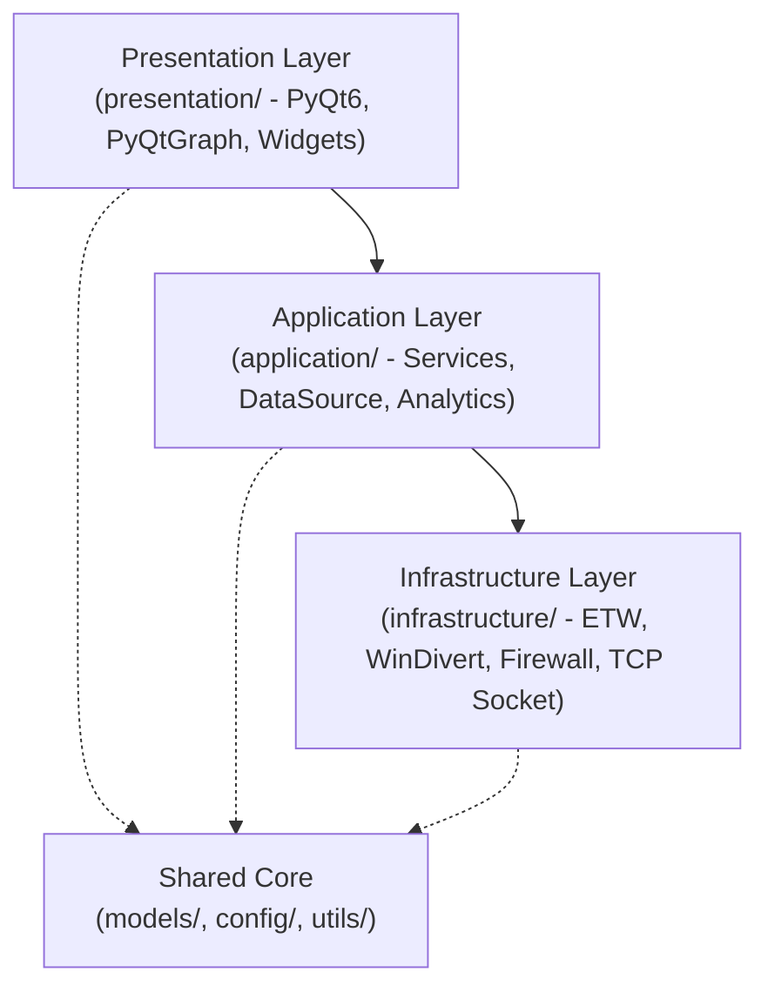

# 🌐 Network Traffic Monitor & Packet Shaper (PBL4)

> **Hệ thống Giám sát Băng thông, Kiểm soát Lưu lượng & Quản lý Tập trung Máy trạm trên Windows**  
> Kết hợp trực quan hóa thời gian thực phong cách *GlassWire* (PyQt6 + PyQtGraph), tương tác tầng nhân Windows (ETW, Windows Defender Firewall, WinDivert Token Bucket Packet Shaper) và giao thức TCP bảo mật PSK + HMAC-SHA256 theo **Kiến trúc 3 lớp (Clean 3-Tier Architecture)**.

---

## 📑 Mục lục

1. [Tổng quan](#-1-tổng-quan)
2. [Tính năng nổi bật](#-2-tính-năng-nổi-bật)
3. [Kiến trúc hệ thống](#-3-kiến-trúc-hệ-thống)
4. [Cấu trúc thư mục](#-4-cấu-trúc-thư-mục)
5. [Yêu cầu hệ thống](#-5-yêu-cầu-hệ-thống)
6. [Cài đặt & Khởi chạy](#-6-cài-đặt--khởi-chạy)
7. [Cấu hình & Bảo mật giao thức](#-7-cấu-hình--bảo-mật-giao-thức)
8. [Kiểm thử, Kiểm tra kiến trúc & Mô phỏng tải](#-8-kiểm-thử-kiểm-tra-kiến-trúc--mô-phỏng-tải)
9. [Đóng gói ứng dụng (.exe)](#-9-đóng-gói-ứng-dụng-exe)
10. [Quản lý Nhật ký (Logging)](#-10-quản-lý-nhật-ký-logging)
11. [Công nghệ sử dụng](#-11-công-nghệ-sử-dụng)

---

## 📌 1. Tổng quan

**Network Traffic Monitor & Packet Shaper** là giải pháp giám sát và điều tiết lưu lượng mạng thời gian thực dành cho hệ điều hành Windows, hỗ trợ linh hoạt **3 chế độ vận hành**:

- **Standalone Mode (`main.py`)**: Giám sát băng thông, phân tích lưu lượng, quét kết nối và áp đặt tường lửa/bóp băng thông trực tiếp trên máy cục bộ.
- **Admin Fleet Server (`admin_main.py`)**: Bảng điều khiển quản trị tập trung theo dõi nhiều máy trạm (Client Agent) trong mạng LAN theo thời gian thực và thực thi chính sách Firewall / QoS từ xa.
- **Client Agent (`client_main.py`)**: Dịch vụ chạy trên máy trạm với System Tray, cửa sổ trạng thái 4 tab, tự động nâng quyền UAC, chẩn đoán mạng và hỗ trợ chạy nền (`--hide`) hoặc không giao diện (`--headless`).

---

## ✨ 2. Tính năng nổi bật

### 📊 Giám sát Băng thông Thời gian thực (Traffic Monitor)
- **Biểu đồ sóng Upload / Download mượt mà**: Ứng dụng làm mịn Gaussian và nội suy Hermite chống rung giật, hỗ trợ phân tích lưu lượng WAN / LAN.
- **Timeline Scrubber**: Kéo tua lại lịch sử, bấm vào bất kỳ thời điểm nào trên biểu đồ để tạm dừng và tra cứu tốc độ chi tiết tại mốc giờ cụ thể.
- **Thống kê Usage & Process Sidebar**: Theo dõi tốc độ (B/s, KB/s, MB/s), tổng dung lượng và mức tiêu thụ của từng tiến trình thông qua **Event Tracing for Windows (ETW)** kết hợp `psutil`.
- **Giám sát Tài nguyên Phần cứng**: Hiển thị trực quan CPU, RAM và Disk I/O theo thời gian thực.

### 🛡️ Bảo vệ & Điều tiết Băng thông (Protect & QoS Packet Shaper)
- **Chặn ứng dụng (Block / Unblock)**: Tích hợp tự động với **Windows Defender Firewall**.
- **Bóp băng thông đa chính sách cô lập (Bandwidth Throttling)**: Sử dụng driver tầng nhân **WinDivert** cùng thuật toán **Token Bucket**, hỗ trợ giới hạn độc lập theo từng tiến trình và hướng lưu lượng (Inbound / Outbound / Both).
- **Phân tầng chính sách 2 lớp trên Client**:
  - 🔒 **Admin Enforced**: Chính sách do máy chủ quản trị áp đặt, được khóa cứng và luôn có độ ưu tiên cao nhất.
  - 🔓 **Local Self-Protect**: Chính sách tự vệ cục bộ do người dùng máy con chủ động thiết lập (không thể ghi đè lên chính sách của Admin).

### 🌐 Quản lý Tập trung (Admin Fleet Management)
- Quản lý danh sách máy trạm Online/Offline, xem thông tin phần cứng/OS, địa chỉ IP và tốc độ tức thời.
- Nhấp chọn từng máy trạm để xem chi tiết biểu đồ lưu lượng, danh sách tiến trình và áp đặt/gỡ bỏ chính sách chặn hoặc giới hạn băng thông từ xa.
- Tự động phát hiện mất kết nối (Heartbeat / Timeout) và khôi phục kết nối lại.

### 🖥️ Giao diện Client Agent (4 Tabs + System Tray)
- **Tab 1 – Giám sát trực tiếp**: Biểu đồ sóng 60 giây, thẻ tốc độ Rx/Tx, CPU/RAM và bảng Top tiến trình kèm nút tự vệ nhanh.
- **Tab 2 – Chính sách an ninh & Audit Log**: Hiển thị rõ chính sách 2 lớp (Admin / Local) và nhật ký kiểm toán.
- **Tab 3 – Chẩn đoán mạng (Diagnostics)**: Kiểm tra kết nối và đo độ trễ tới Admin Server cũng như Internet Gateway.
- **Tab 4 – Cấu hình & Định danh**: Chỉnh sửa `server_host`, `server_port`, bật/tắt ETW, thông báo Toast và xem thông tin thiết bị.

### 🔍 Quét Kết nối & Phân tích Nhật ký (Network Scanner & Log Analysis)
- **Network Scanner**: Liệt kê các kết nối socket đang hoạt động (Local IP/Port, Remote IP/Port, giao thức TCP/UDP, trạng thái `ESTABLISHED`, `LISTEN`,...).
- **Log Analysis**: Tra cứu, tìm kiếm và lọc lịch sử thao tác chính sách (`logs/policies.log`) và lịch sử kết nối (`logs/connections.log`).

---

## 🏗️ 3. Kiến trúc hệ thống

Dự án áp dụng nghiêm ngặt **Kiến trúc 3 lớp (3-Tier / Clean Architecture)** với luồng phụ thuộc một chiều, kết hợp **Strategy Pattern** (`application/data_source.py`) để dùng chung giao diện Dashboard cho cả 3 chế độ Standalone, Client và Admin Fleet:



Quy tắc phụ thuộc giữa các tầng được kiểm tra tự động bằng AST thông qua [`utils/arch_linter.py`](utils/arch_linter.py) và [`tests/test_three_tier_architecture.py`](tests/test_three_tier_architecture.py):
- `presentation/` **không** import `infrastructure.*`, `psutil`, `subprocess`, `socket`, `winreg`, `utils.file_logger`.
- `application/` **không** import `presentation.*`, `PyQt6`, `psutil`, `socket`, `winreg`.
- `infrastructure/` **không** import `application.*`, `presentation.*`, `PyQt6`.

---

## 📂 4. Cấu trúc thư mục

```text
demo-pbl4-fresh/
├── main.py                                  # Khởi chạy chế độ Độc lập (Standalone)
├── admin_main.py                            # Khởi chạy Máy chủ Quản trị (Admin Fleet Server)
├── client_main.py                           # Khởi chạy Máy trạm (Client Agent: Tray / GUI / Headless)
├── build_dist.py                            # Script đóng gói PyInstaller (.exe) kèm driver WinDivert
├── stress_test_fleet.py                     # Công cụ mô phỏng tải 50–150+ máy trạm thực tế
├── requirements.txt                         # Danh sách thư viện Python phụ thuộc
│
├── config/                                  # Cấu hình hệ thống
│   ├── settings.py                          # Chu kỳ lấy mẫu, cổng TCP, cấu hình PSK & timeout
│   └── client_config.json                   # Cấu hình kết nối mặc định của Client Agent
│
├── models/                                  # Thực thể dữ liệu & Giao thức (Domain Models)
│   ├── network_sample.py                    # Dữ liệu mẫu băng thông & tiến trình
│   └── network_protocol.py                  # Gói tin Telemetry, Registration, Command & Result
│
├── application/                             # Tầng nghiệp vụ (Business Logic)
│   ├── monitor_service.py                   # Điều phối giám sát cục bộ (Standalone)
│   ├── fleet_manager_service.py             # Quản lý tập trung đội ngũ máy trạm (Admin)
│   ├── client_agent_service.py              # Dịch vụ Agent trên máy trạm
│   ├── client_policy_manager.py             # Quản lý chính sách an ninh 2 lớp (Admin / Local)
│   ├── client_diagnostics.py                # Chẩn đoán kết nối & đo độ trễ mạng
│   ├── data_source.py                       # Strategy Pattern cho Local / Client / Remote Dashboard
│   ├── bandwidth_calculator.py              # Tính toán delta tốc độ mạng
│   ├── process_aggregator.py                # Tổng hợp lưu lượng theo tiến trình
│   ├── traffic_analytics.py                 # Phân tích & định dạng thống kê lưu lượng
│   ├── wave_chart_math.py                   # Thuật toán làm mịn Gaussian & nội suy sóng biểu đồ
│   ├── network_classifier.py                # Phân loại lưu lượng WAN / LAN
│   └── audit_logger.py                      # Ghi nhận sự kiện kiểm toán chính sách
│
├── infrastructure/                          # Tầng hạ tầng (Kernel, OS & Network I/O)
│   ├── etw_consumer.py                      # Consumer đọc sự kiện mạng từ Windows ETW
│   ├── etw_ctypes.py                        # Khai báo cấu trúc Win32 API / ETW ctypes
│   ├── etw_tdh_parser.py                    # Phân tích sự kiện TDH từ luồng ETW
│   ├── network_collector.py                 # Thu thập chỉ số mạng & phần cứng qua psutil
│   ├── packet_shaper.py                     # Điều phối WinDivert bóp băng thông đa chính sách
│   ├── divert_engine.py                     # Vòng lặp can thiệp gói tin tầng nhân WinDivert
│   ├── shaper_models.py                     # Mô hình Token Bucket & cấu hình chính sách QoS
│   ├── port_tracker.py                      # Ánh xạ Port <-> PID thời gian thực
│   ├── firewall_helper.py                   # Quản lý quy tắc Windows Defender Firewall
│   ├── os_integration.py                    # Tích hợp hệ điều hành & truy vấn hệ thống
│   ├── protocol_framing.py                  # Đóng gói khung nhị phân [Length][Seq][HMAC]
│   ├── auth_handshake.py                    # Bắt tay xác thực 2 chiều PSK + Challenge-Response
│   ├── network_server.py                    # TCP Server đa kết nối & xác thực Client
│   └── network_client.py                    # TCP Client tự kết nối lại, Heartbeat & khử trùng lặp lệnh
│
├── presentation/                            # Tầng giao diện người dùng (PyQt6 + PyQtGraph)
│   ├── dashboard.py                         # Cửa sổ chính tổ hợp các trang chức năng
│   ├── admin_fleet_view.py                  # Trang quản lý danh sách máy trạm (Admin)
│   ├── traffic_monitor_page.py              # Trang giám sát băng thông tổng hợp
│   ├── traffic_chart_canvas.py              # Biểu đồ sóng lưu lượng thời gian thực
│   ├── traffic_sidebar_panel.py             # Thanh bên hiển thị Top tiến trình
│   ├── traffic_usage_view.py                # Thống kê lịch sử sử dụng lưu lượng
│   ├── protect_view.py                      # Trang quản lý Firewall & QoS Throttling
│   ├── log_analysis_view.py                 # Trang tra cứu & lọc nhật ký hoạt động
│   ├── network_scanner_view.py              # Trang quét kết nối Socket TCP/UDP
│   ├── client_status_window.py              # Cửa sổ 4 tab dành riêng cho Client Agent
│   ├── client_tray.py                       # Biểu tượng System Tray & thông báo Toast
│   ├── glasswire_icons.py                   # Bộ biểu tượng vector giao diện
│   ├── styles.py                            # Theme & stylesheet PyQt6
│   └── widgets/                             # Các widget giao diện tái sử dụng
│       ├── chart_scrubber_widgets.py        # Timeline Scrubber & Inspection Bar
│       ├── dashboard_widgets.py             # ProcessIconManager, AsyncSignalBridge, Worker
│       ├── hud_widgets.py                   # ArcGauge, WanLanWidget & thẻ thông số HUD
│       ├── process_workers.py               # Worker tải biểu tượng/thông tin bất đồng bộ
│       ├── protect_widgets.py               # Widget cấu hình chính sách Protect
│       └── sparkline_widget.py              # Biểu đồ sóng mini (Bezier Sparkline) cho Client
│
├── logs/                                    # Thư mục nhật ký (tự xoay vòng 5MB x 3)
│   ├── policies.log                         # Lịch sử thao tác chặn / giới hạn băng thông
│   └── connections.log                      # Lịch sử phiên kết nối mạng
│
├── tests/                                   # Bộ kiểm thử tự động (13 module unittest)
└── utils/                                   # Tiện ích dùng chung
    ├── arch_linter.py                       # Công cụ kiểm tra kiến trúc 3 lớp & độ dài file
    ├── env_setup.py                         # Thiết lập môi trường & mã hóa UTF-8
    ├── file_logger.py                       # Ghi log thread-safe có xoay vòng tự động
    └── safe_print.py                        # In console an toàn UTF-8 tiếng Việt
```

---

## ⚙️ 5. Yêu cầu hệ thống

- **Hệ điều hành**: Windows 10 / Windows 11 (64-bit).
- **Python**: Phiên bản **3.10 trở lên**.
- **Quyền thực thi**: Khuyến nghị chạy với quyền **Administrator** để kích hoạt đầy đủ ETW Kernel Tracing, Windows Defender Firewall và driver WinDivert.

---

## 🚀 6. Cài đặt & Khởi chạy

### Bước 1: Thiết lập môi trường ảo & cài đặt thư viện

Mở PowerShell tại thư mục dự án:

```powershell
python -m venv venv
.\venv\Scripts\Activate.ps1
pip install -r requirements.txt
```

### Bước 2: Khởi chạy theo chế độ mong muốn

#### 1. Chế độ Độc lập (Standalone Monitor)
```powershell
python main.py
```

#### 2. Chế độ Máy chủ Quản trị (Admin Fleet Server)
```powershell
python admin_main.py --host 0.0.0.0 --port 9988
```

#### 3. Chế độ Máy trạm (Client Agent)
```powershell
# Chế độ chuẩn: System Tray + Cửa sổ trạng thái 4 tab
python client_main.py --server 127.0.0.1 --port 9988

# Chạy ẩn xuống khay hệ thống (System Tray)
python client_main.py --server 192.168.1.10 --port 9988 --hide

# Mở giao diện Dashboard đầy đủ kết hợp Agent
python client_main.py --server 192.168.1.10 --port 9988 --full-gui

# Chạy nền dòng lệnh thuần túy (không GUI / không Tray)
python client_main.py --server 192.168.1.10 --port 9988 --headless
```

**Các cờ dòng lệnh hỗ trợ trên `client_main.py`:**

| Tham số | Mô tả |
| :--- | :--- |
| `--server <IP>` | Địa chỉ IP máy chủ Admin (ghi đè `config/client_config.json`) |
| `--port <PORT>` | Cổng TCP máy chủ Admin (mặc định `9988`) |
| `--hide` | Khởi động ẩn xuống khay hệ thống (System Tray) |
| `--full-gui` | Mở giao diện `BandwidthDashboard` đầy đủ |
| `--headless` | Chạy dạng dịch vụ dòng lệnh không có GUI/Tray |
| `--no-etw` | Tắt ETW Consumer (chỉ dùng số liệu tổng hợp `psutil`) |
| `--no-elevate` | Bỏ qua tự động gọi hộp thoại UAC yêu cầu quyền Administrator |

> [!TIP]
> Để theo dõi lưu lượng chi tiết đến từng tiến trình qua ETW và sử dụng tính năng chặn/bóp băng thông WinDivert, hãy chạy PowerShell bằng tùy chọn **Run as Administrator**.

---

## 🔐 7. Cấu hình & Bảo mật giao thức

### Cấu hình kết nối Client (`config/client_config.json`)
```json
{
  "server_host": "127.0.0.1",
  "server_port": 9988,
  "enable_etw": true,
  "show_toast_notifications": true
}
```

### Bảo mật kênh truyền TCP (Admin ↔ Client)
- **Xác thực 2 chiều (Mutual Challenge-Response)**: Sử dụng Pre-Shared Key (PSK) kết hợp **HMAC-SHA256** để xác thực lẫn nhau và dẫn xuất khóa phiên (Session Key) riêng cho từng kết nối (`infrastructure/auth_handshake.py`).
- **Toàn vẹn & Chống phát lại (Anti-Replay)**: Mọi khung dữ liệu nhị phân tuân theo định dạng `[Length][Seq][HMAC][Payload]` (`infrastructure/protocol_framing.py`), kiểm tra số thứ tự tuần tự và giới hạn số kết nối chờ xác thực (`MAX_PENDING_AUTH = 32`, `AUTH_TIMEOUT = 5.0s`).
- **Thiết lập khóa PSK riêng khi triển khai mạng LAN** (cần đặt giống nhau trên cả Admin Server và Client Agent):

```powershell
$env:PBL4_PSK = "Your-Strong-PreShared-Key"
```

---

## 🧪 8. Kiểm thử, Kiểm tra kiến trúc & Mô phỏng tải

### Chạy toàn bộ bộ kiểm thử tự động (Unit & Regression Tests)
```powershell
python -m unittest discover -s tests -v
```

### Kiểm tra tuân thủ Kiến trúc 3 lớp (AST Architecture Linter)
```powershell
python utils/arch_linter.py
```

### Mô phỏng tải quy mô lớn (Fleet Stress Simulator)
Giả lập 50–150+ máy trạm thuộc nhiều phân khu (Lab CNTT, AI/Dev, Studio, Gaming, Văn phòng) với lưu lượng sinh học theo thời gian và phản hồi trực tiếp lệnh `BLOCK_APP` / `THROTTLE_SET` từ Admin Dashboard:

```powershell
# Khởi chạy Admin Server trước, sau đó chạy kịch bản mô phỏng ở terminal khác:
python stress_test_fleet.py --port 9988 --clients 60 --interval 1.0
```

---

## 📦 9. Đóng gói ứng dụng (.exe)

Dự án cung cấp script tự động đóng gói bằng **PyInstaller** (cần cài thêm `pip install pyinstaller`):

```powershell
python build_dist.py
```

Kết quả đầu ra nằm trong thư mục `dist/`:
- `dist/Admin_Server/Admin_Server.exe` — Gói thực thi Máy chủ Quản trị (tích hợp UAC manifest & hướng dẫn vận hành).
- `dist/Client_Agent/Client_Agent.exe` — Gói thực thi Máy trạm (tự động đóng gói kèm `WinDivert64.dll`, `WinDivert64.sys` và `config/client_config.json`).

---

## 📜 10. Quản lý Nhật ký (Logging)

Hệ thống ghi nhật ký văn bản an toàn đa luồng (thread-safe) vào thư mục `logs/` với cơ chế **tự động xoay vòng khi vượt quá 5 MB** (giữ tối đa 3 bản sao lưu `.1`–`.3`):

- **`logs/policies.log`**: Ghi lại toàn bộ lịch sử thao tác an ninh (`POLICY_BLOCK`, `POLICY_UNBLOCK`, `POLICY_APPLY`, `POLICY_REMOVE`) kèm thời gian, tên tiến trình, hướng lưu lượng, mức trần tốc độ và trạng thái thực thi.
- **`logs/connections.log`**: Lưu trữ các phiên kết nối TCP/UDP của tiến trình kèm địa chỉ Local, Remote và trạng thái socket.

---

## 🛠️ 11. Công nghệ sử dụng

- **Giao diện người dùng (GUI)**: [PyQt6](https://www.riverbankcomputing.com/software/pyqt/)
- **Biểu đồ thời gian thực**: [PyQtGraph](https://www.pyqtgraph.org/)
- **Xử lý số liệu & làm mịn sóng**: [NumPy](https://numpy.org/)
- **Giám sát hệ thống & Kernel**: [psutil](https://github.com/giampaolo/psutil), Windows ETW (Event Tracing for Windows), Win32 API (`ctypes`)
- **Điều tiết gói tin tầng nhân**: [pydivert](https://github.com/ffalcinelli/pydivert) (WinDivert 64-bit Kernel Driver) & Windows Defender Firewall
- **Bảo mật & Đóng gói**: HMAC-SHA256 (`hmac`/`hashlib`), [PyInstaller](https://pyinstaller.org/)
